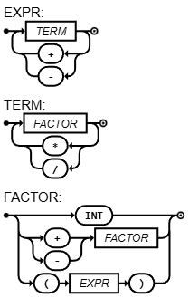

# Compilador de Linguagem e Paradigmas, realizado em Go

[](https://compiler-tester.insper-comp.com.br/svg/scalcogigi/compilador)



```ebnf

EXPRESSION = TERM, { ("+" | "-"), TERM } ;
TERM = FACTOR, { ("*" | "/"), FACTOR } ;
FACTOR = ("+" | "-"), FACTOR | "(", EXPRESSION, ")" | NUMBER ;
NUMBER = DIGIT, {DIGIT} ;
DIGIT = 0 | 1 | ... | 9 ;


```